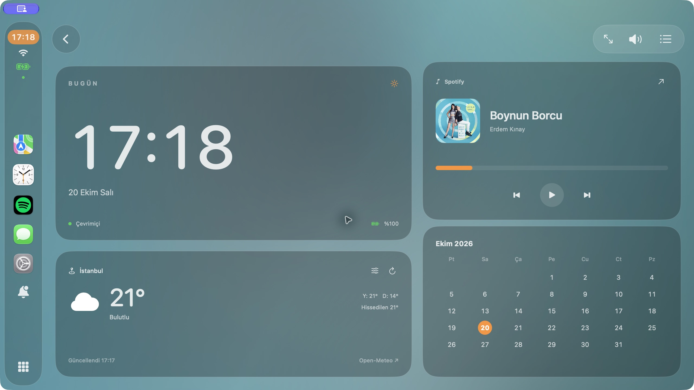
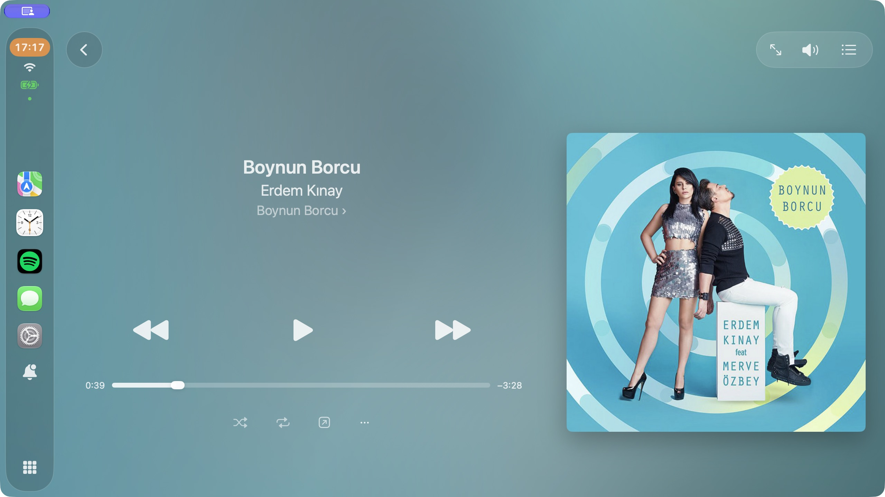
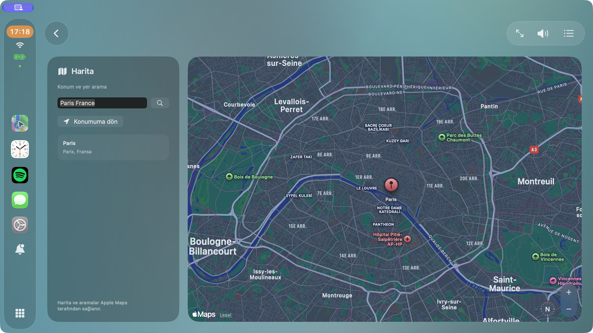
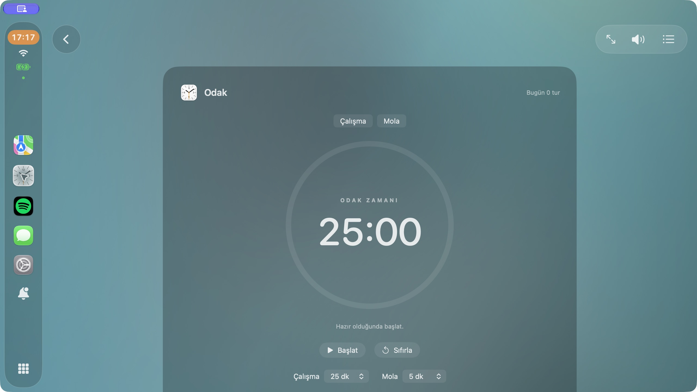

# Veyra

A native SwiftUI dashboard for macOS 14 and later, with an immersive music player, live weather, an embedded Apple map, route previews, and a focus timer.

## Screenshots

### Dashboard

Clock, calendar, live weather, and music controls in one view.



### Music

Album artwork, adaptive backgrounds, and playback controls.



<table>
  <tr>
    <td width="50%"></td>
    <td width="50%"></td>
  </tr>
  <tr>
    <td align="center"><strong>Maps</strong> — in-app place search and route previews</td>
    <td align="center"><strong>Focus</strong> — work and break sessions</td>
  </tr>
</table>

Screenshots use example locations (Istanbul and Paris). Album artwork and third-party marks belong to their respective owners.

## Features

- Spotify and Apple Music controls, remembered source selection, and automatic connection
- Album artwork and adaptive backgrounds; smooth playback progress
- Dashboard with clock, monthly calendar, battery and connection status
- Location-based weather from Open-Meteo with manual city selection
- Embedded Apple Maps, place search, driving/walking routes, and directions
- Focus timer with work/break durations, pause/resume, and daily sessions
- Menu bar controls, full-screen mode, and optional idle activation

Route previews start at an approximate location; they are not live turn-by-turn navigation. The focus timer does not modify macOS Focus settings. Apple Music artwork is not yet integrated. Veyra's notification panel shows its own connection and power events, not other apps' notifications.

## Install with Homebrew

The repository doubles as a custom Homebrew tap; its explicit URL is required because it is not named `homebrew-veyra`.

```sh
brew tap celiloz/veyra https://github.com/celiloz/veyra.git
brew install --cask celiloz/veyra/veyra
```

The current **[v0.1.4 release](https://github.com/celiloz/veyra/releases/tag/v0.1.4)** is for **Apple Silicon Macs (M1 and later), macOS 14+**. It is Developer ID signed and **notarized by Apple**, with the notarization ticket attached for offline verification. The packaged application passed Gatekeeper verification (`accepted`, `Notarized Developer ID`). No quarantine or system security settings are disabled by the cask.

v0.1.4 is a distribution package revision of the same signed application; the app bundle retains version 0.1.0 (build 1). Existing Homebrew users can run `brew update` followed by `brew upgrade --cask celiloz/veyra/veyra`.

If your Homebrew configuration explicitly requires tap trust, trust only this cask:

```sh
brew trust --cask celiloz/veyra/veyra
```

Then retry the install command above.

## Build from source

Open `Veyra.xcodeproj` in Xcode and run the Veyra scheme, or:

```sh
xcodebuild -project Veyra.xcodeproj -scheme Veyra -configuration Debug CODE_SIGN_IDENTITY=- build
```

## Release packaging

Requires Xcode. Build an Apple Silicon + Intel development package:

```sh
./scripts/package.sh 0.1.0
python3 scripts/update-cask.py 0.1.0 dist/Veyra-0.1.0-universal.zip
```

For public distribution, use a Developer ID Application certificate in your login keychain and a previously stored `notarytool` keychain profile:

```sh
DEVELOPER_ID_APPLICATION="Developer ID Application: Your Name (TEAMID)" \
NOTARY_PROFILE="veyra-notary" ./scripts/package.sh 0.1.0
```

After packaging, generate the cask from the final ZIP, commit it, and upload that exact ZIP and its `.sha256` to the `v0.1.0` GitHub release. Publish new versions rather than changing an already released archive. Never commit certificates, private keys, or passwords. See [Apple's distribution guide](https://developer.apple.com/developer-id/).

## Permissions and privacy

- Automation: controlling the selected Spotify or Apple Music desktop app
- Location: optional weather and map positioning
- Approximate coordinates are sent to Open-Meteo for weather and Apple for locality/map services. The Mac's location is not persisted by Veyra. Manually selected cities are remembered locally.
- City searches use Open-Meteo; map searches and route requests use Apple Maps.
- Network access is required for weather, cover art, maps, and place searches.

Weather data: [Open-Meteo](https://open-meteo.com/) (CC BY 4.0). Map data and route previews: Apple Maps. Apple system app icons are obtained from the user's own macOS installation at runtime. They are not bundled in this repository. Focus does not imply Apple endorsement.
